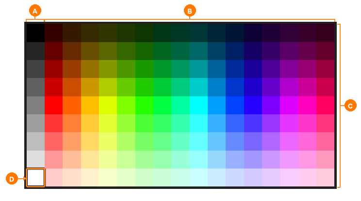
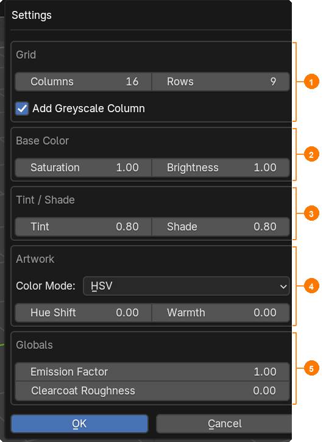

# Farbpalette und PBR-Presets

In Low Poly Colorizer werden Farbgebung (Albedo) und Oberflächenbeschaffenheit (PBR-Werte) getrennt gesteuert und erst beim Rendern bzw. Shading miteinander kombiniert.

---

## Der interaktive Modal Palette Picker

Klicken Sie im N-Panel auf den **Paletten-Button** (Farbwähler), öffnet sich die Farbpalette als hardwarebeschleunigtes GPU-Overlay direkt im 3D-Viewport.

| Bereich | Beschreibung |
|:---:|:---|
| **Ⓐ** | **Graustufenspalte (Spalte 0)**: Reine Graustufen von Schwarz (oben) bis Weiß (unten) für monochrome Flächen oder neutrale Schattierungen. |
| **Ⓑ** | **Farbton-Spektrum (Spalten 1–16)**: Der vollständige HSV-Farbkreis von Rot über Gelb, Grün, Cyan, Blau bis Magenta horizontal aufgefächert. |
| **Ⓒ** | **Helligkeits- & Sättigungsverlauf (Zeilen 0–8)**: Vertikale Abstufung von tiefdunklen Schatten (oben) über satte Farben bis hin zu hellen Pastelltönen (unten). Zeile 0 ist die unterste Zeile. |
| **Ⓓ** | **Aktive Zelle & Selektionsrahmen**: Zweifarbiger Markierungsrahmen um die momentan gewählte Palettenzelle $(X, Y)$ mit direkter Zuweisung per Klick. |

Die Spalten- und Zeilennummern beziehen sich auf das Standard-Raster (Graustufenspalte + 16 Farbtöne × 9 Zeilen); beides lässt sich unter *Settings…* ändern.

### Steuerung im Picker-Overlay

* **Auswählen & Zuweisen**: Klicken Sie mit der **linken Maustaste** auf die gewünschte Zelle. Die Zelle wird gespeichert, der aktuellen Auswahl zugewiesen und das Overlay schließt sich.
* **Zoomen**: Drehen Sie das **Mausrad**, um stufenlos in die Palette hinein- oder herauszuzoomen (0.25× bis 4.0×).
* **Verschieben (Pan)**: Halten Sie die **mittlere Maustaste (MMB)** gedrückt und ziehen Sie die Maus, um das Palettenfenster im Viewport zu bewegen.
* **Abbrechen**: Mit **Rechtsklick**, **Escape** oder einem Linksklick außerhalb der Palette schließen Sie das Overlay, ohne die bisherige Farbauswahl zu verändern.

---

## PBR-Presets: Materialeigenschaften steuern

Jedes Preset bündelt vier standardisierte physikalische Materialparameter:

* **Roughness (0.0 – 1.0)**: Oberflächen-Rauheit. Niedrige Werte erzeugen spiegelnde Oberflächen, hohe Werte ein mattes Finish.
* **Metallic (0.0 – 1.0)**: Metallischer Anteil. 0.0 entspricht Dielektrika (Plastik, Holz, Stein), 1.0 echtem Metall.
* **Emission (0.0 – 1.0)**: Eigenleuchtkraft der Fläche, skaliert mit dem globalen *Emission Factor* (*Settings…*). Die Albedo-Farbe der Palettenzelle wird als Leuchtfarbe herangezogen.
* **Clearcoat (0.0 – 1.0)**: Klarlack-Schicht (z. B. für Autolacke, polierte Oberflächen oder nasse Optiken).

> [!IMPORTANT]
> **Live-Aktualisierung:** Die Preset-Regler modifizieren keine individuellen Meshes, sondern die zentrale Lookup-Tabelle. Ändern Sie beispielsweise die *Roughness* des Presets *Solid*, aktualisieren sich **augenblicklich alle Flächen, die *Solid* nutzen**.

### Preset-Zusatzfunktionen (Menü `▾`)

* **Duplicate**: Erstellt eine 1:1-Kopie des aktiven Presets, um rasch Variationen zu erzeugen.
* **Import / Export JSON**: Ermöglicht das Speichern und Laden von Preset-Sets als handliche Textdateien – ideal zur Wiederverwendung in anderen Projekten. Beim Import werden Presets mit bereits vorhandenem Namen aktualisiert, neue werden angehängt.
* **Load Default Presets**: Ergänzt fehlende der vier mitgelieferten Werks-Presets (*Solid*, *Metallic*, *Clearcoat*, *Emission*) und setzt gleichnamige Presets auf die Werkswerte zurück.
* **Create Geometry Node Group**: Siehe Kapitel *Engine-Export und Integration*.

---

## Globale Einstellungen (*Settings…*)

Über den Button **Settings…** im N-Panel öffnen Sie das Konfigurationsfenster für projektspezifische Paletten- und Shader-Parameter. Änderungen werden live angezeigt; *Cancel* nimmt sie zurück.

| Bereich | Beschreibung |
|:---:|:---|
| **①** | **Grid**: Anzahl der Farbton-Spalten (*Columns*, ohne Graustufenspalte) und Zeilen (*Rows*) sowie Umschalter für die monochrome Graustufenspalte (*Add Greyscale Column*). |
| **②** | **Base Color**: Grundsättigung (*Saturation*) und Basishelligkeit (*Brightness*) aller Farbtöne im Farbkreis. |
| **③** | **Tint / Shade**: Intensität der vertikalen Abstufungen (Aufhellung durch *Tint*, Abdunklung durch *Shade*). |
| **④** | **Artwork**: Farbraum (**Color Mode**: *HSV* oder *OKLCH*), vertikaler Farbtemperatur-Drift (**Hue Shift**) und globale Farbtemperatur (**Warmth**). |
| **⑤** | **Globals**: Projektweite Parameter wie der globale Emissions-Skalierungsfaktor (*Emission Factor*) und die Grund-Rauheit für Klarlack (*Clearcoat Roughness*). |

---

## Artwork: Farblehre und Shading-Harmonisierung

Klassische Farbpaletten auf Basis des mathematischen HSV-Farbraums führen bei 3D-Shading häufig zu unerwünschten Effekten: Gelbtöne bleichen in hellen Stufen rasch zu grellem Weiß aus, während Blau- und Violetttöne in Schattenstufen schmutzig oder entsättigt wirken. Zudem nutzt professionelle 3D-Grafik und Malerei selten reine Helligkeitsabstufungen, sondern arbeitet mit **Farbtemperatur-Kontrasten** (warmes Sonnenlicht erzeugt kühle Schatten).

Die Sektion **Artwork** bietet gezielte Stellschrauben für harmonische und stilisierte Farbverläufe:

### Farbräume: HSV vs. OKLCH

* **HSV (Standard / Legacy)**: Rein technischer Farbraum (`V = max(R, G, B)`). Garantiert 100 % Abwärtskompatibilität zu bestehenden Projekten und erzeugt den typisch knalligen Retro-Arcade-Look.
* **OKLCH (Perzeptuell gleichförmig)**: Basiert auf der menschlichen Farbwahrnehmung. Gleiche Helligkeitswerte (*L*) besitzen über das gesamte Farbspektrum dieselbe wahrgenommene Helligkeit. Gelbtöne behalten ihren sonnigen Charakter, Blautöne bleiben klar und Schattenstufen saufen nicht unkontrolliert ab.

### Farbtemperatur-Steuerung

* **Hue Shift (-1.0 bis +1.0)**: Simuliert atmosphärisches Shading.
  * *Positive Werte (0.3 bis 0.5)*: Highlights driften zur warmen Farbachse (Gelb/Gold), Schatten wandern zur kühlen Achse (Blau/Violett) – ideal für sonnige Außenszenen.
  * *Negative Werte (-0.3 bis -0.5)*: Kühle Lichter und wärmere Schatten – ideal für Nacht- und Mondscheinszenen.
  * *0.0*: Neutrale Farbtöne ohne Drift.
* **Warmth (-1.0 bis +1.0)**: Globaler Farbtemperatur-Bias. Verschiebt das gesamte Farbspektrum sowie die Graustufenspalte subtil in Richtung Bernstein/Gold (+1.0) oder kühles Himmelblau (-1.0).

### Empfohlene Einstellungen (Rezepte)

* **Moderner Low-Poly-Look (Outdoor / Sonne)**: `OKLCH`, `Hue Shift: 0.35`, `Warmth: 0.15`.
* **Nacht / Sci-Fi / Mondschein**: `OKLCH`, `Hue Shift: -0.35`, `Warmth: -0.25`.
* **Klassischer Retro-Arcade-Look**: `HSV`, `Hue Shift: 0.0`, `Warmth: 0.0`.

