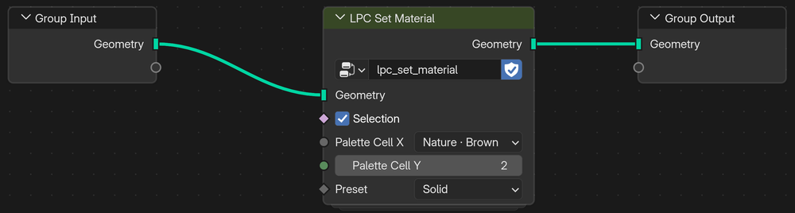

# Engine-Export und Integration

Low Poly Colorizer nutzt ein generisches, templatebasiertes Export-System (`.tpl`), das flexibel auf weitere Engines erweiterbar ist. Als mitgeliefertes Standard-Target dient **Godot 4** (*Godot Materials*); die exportierten Dateien benötigen **Godot 4.4 oder neuer**.

## Der 1-Klick Export nach Godot

LPC exportiert **keine Meshes** (Modelle importieren Sie als `.blend` oder glTF mit ihren `lpc_uv0`/`lpc_uv1`-Maps). Der **Export-Button** öffnet einen Ordner-Dialog und schreibt vorbereitete Materialien, Shader und Hilfsklassen in den gewählten Ordner:

* **Texturen**: `lpc_palette.png` (eine sRGB-Farbe je Palettenzelle, die Shader dekodieren sie per `source_color`) und `lpc_preset_lut.png` (PBR-Lookup-Tabelle, Rohdaten), jeweils mit passender `.import`-Datei, sodass Godot sie ohne manuelle Einstellungen korrekt importiert.
* **Paletten-Spickzettel**: `lpc_palette_cheatsheet.png` zeigt unter einer Titelzeile mit dem Palettennamen die Palette wie im Picker – mit Gruppennamen, Zeilennummern und den Spaltennamen senkrecht unter jeder Spalte – zum Nachschlagen von Zellen. Die zugehörige `.import`-Datei weist Godot an, die Datei zu überspringen: Sie wird weder importiert noch mit dem Spiel exportiert; öffnen Sie sie in einem Bildbetrachter.
* **Shader & Materialien**: Vorkonfigurierte ShaderMaterials (`.tres`), Shader (`.gdshader`) und Shared-Code (`.gdshaderinc`) – in zwei Varianten, `lpc_multicolor` und `lpc_singlecolor`.
* **Hilfsklassen**: GDScript-Klasse `lpc_palette_color_resource.gd` für eine reine Palettenfarbe (nur Palettenzelle, ohne Preset und Emission) – etwa für Decals, Beschriftungen, UI oder Lichter. Davon abgeleitet `lpc_singlecolor_resource.gd` für wiederverwendbare, benannte Looks (Palettenzelle, Preset, Emission) mit generiertem `Preset`-Enum. Beide liefern die Farbe ihrer Zelle per `get_color()` und zeigen sie im Inspektor im schreibgeschützten Feld `color` an (wird nicht gespeichert, folgt immer der Zelle).
* **Feste UIDs**: Jede exportierte Datei trägt eine stabile UID (`.uid`-/`.import`-Datei bzw. `.tres`-Kopf), die nur vom Dateinamen abhängt. Verweise per UID bleiben so über erneute Exporte hinweg gültig.
* **Hinweise**: `README.md` mit Erläuterungen zu Texturen, UIDs und Hilfsklassen.
* **Dirty-Flag-Erkennung**: Der Button leuchtet rot, sobald der letzte Export veraltet ist, und neutral im synchronen Zustand.

## Die Dateien in Godot verwenden

1. **Export in den Godot-Projektordner**: Wählen Sie einen Ordner innerhalb Ihres Godot-Projekts. Die mitexportierten `.import`-Dateien setzen die nötigen Import-Einstellungen der beiden Texturen automatisch (verlustfrei, ohne VRAM-Kompression und Mipmaps, *Fix Alpha Border* aus). Ändern Sie diese Einstellungen nicht – jeder Export stellt sie wieder her.
2. **Bemalte Meshes**: Weisen Sie dem importierten Mesh `lpc_multicolor.tres` als Material-Override zu. Es liest Farbe und Preset pro Fläche aus UV/UV2.
3. **Andere Meshes** (nicht in LPC bemalt): Verwenden Sie `lpc_singlecolor.tres`. Palettenzelle, Preset und Emission werden pro `MeshInstance3D` als Instance-Shader-Parameter gesetzt – viele Objekte teilen sich so ein Material und sehen trotzdem unterschiedlich aus. Auch dort ist die Palettenspalte (`lpc_palette_cell_x`) ein Auswahlfeld mit den Spaltennamen (z. B. *Nature · Moss*) und das Preset (`lpc_preset_position`) eines mit den Preset-Namen; gespeichert werden die Nummern.
4. **Nur die Farbe**: Wo kein LPC-Shader läuft (Decal, `Label3D`, UI, Licht), typisieren Sie Exporte als `LpcPaletteColorResource` und lesen die Farbe mit `get_color()`. Ein solches Feld akzeptiert auch jeden `LpcSinglecolorResource`-Look. Anders als ein fester `Color`-Wert folgt die Farbe Palettenänderungen beim nächsten Export.
   Im Inspektor ist die Palettenspalte (`palette_cell_x`) ein Auswahlfeld mit den Spaltennamen (z. B. *Nature · Moss*); gespeichert wird die Nummer. Für eigenen Code enthält das Skript zusätzlich `PALETTE_GROUPS` und `PALETTE_COLUMN_NAMES`.
   > [!WARNING]
   > Hinzufügen, Entfernen oder Umsortieren von Palettenspalten verschiebt die Spaltennummern. LPC rechnet die bemalten Meshes um, gespeicherte `.tres`-Dateien behalten aber ihre Nummer und zeigen nach dem nächsten Export auf eine andere Spalte – prüfen Sie sie nach einem solchen Umbau (wie bei Preset-Positionen).
5. **Arbeitsablauf**: Änderungen an bemalten Flächen reisen mit dem Modell – Godot übernimmt sie beim Reimport der `.blend` bzw. glTF. Ein neuer LPC-Export ist nur nötig, wenn der Export-Button rot ist.

## Prozedurale Workflows mit Geometry Nodes

Für prozedurale Meshes erzeugen Sie über das Preset-Zusatzmenü (**▾**) mit **Create Geometry Node Group** die Node-Gruppe `lpc_set_material`:

1. LPC erstellt die Node-Gruppe und bindet sie als Geometry-Nodes-Modifier an das aktive Objekt.
2. Im Modifier oder im Node-Editor wählen Sie Palettenzelle und Preset über die Eingangs-Sockets. Das Material `lpc_multicolor` übernimmt das Shading automatisch.
   - **Palette Cell X** ist ein Dropdown der Palettenspalten mit Namen („Gruppe · Spalte“, z. B. *Nature · Moss*), dieselbe Liste wie `palette_cell_x` der exportierten Godot-Ressource. Intern wird daraus die Spaltennummer; ändern Sie die Palette, behält ein Modifier seine Spaltennummer.
   - **Palette Cell Y** ist die Zeilennummer, von 0 (hellste) bis zur dunkelsten Zeile.
   - **Preset** ist ein Dropdown der Presets der Szene.

## Wartung: UV-Maps reparieren (*Fix UV Maps*)

Low Poly Colorizer nutzt zwei definierte UV-Kanäle: `lpc_uv0` (Paletten-Farbkoordinaten) und `lpc_uv1` (Preset-LUT-Koordinaten).

Werden Meshes zusammengefügt (`Ctrl + J`), durch Booleans zerschnitten oder importiert, können UV-Kanäle vertauscht sein oder fehlen. LPC blendet in diesem Fall am unteren Rand des N-Panels automatisch eine Warnbox ein:

> [!WARNING]
> **UV maps need fixing:** Ein Klick auf den Button **Fix UV Maps** (nur im Object Mode) legt fehlende LPC-UV-Maps neu an, verschiebt `lpc_uv0` / `lpc_uv1` auf die ersten beiden UV-Slots und sichert den sauberen Import in Godot. Musste `lpc_uv0` neu angelegt werden, sind die Palettenfarben der betroffenen Flächen verloren – LPC meldet das, und diese Flächen müssen neu bemalt werden.

## Troubleshooting-Checkliste

| Problem | Ursache | Lösung |
|:---|:---|:---|
| **Keine Farben im Viewport** | 3D-Viewport steht auf *Wireframe* oder *Solid* ohne Texture-Preview. | Schalten Sie mit `Z` in den Shading-Modus **Material Preview** oder **Rendered**. |
| **Flächen färben sich nicht** | Im Edit Mode ist keine Fläche markiert oder kein Preset aktiv. | Flächen mit `A` oder `L` selektieren und sicherstellen, dass in der Liste ein Preset markiert ist. |
| **Minus-Button (`-`) gesperrt** | Das ausgewählte Preset wird noch von Flächen verwendet (Refcount > 0). | Bemalen Sie diese Flächen mit einem anderen Preset. *Select* findet Flächen mit aktueller Farbe **und** aktuellem Preset – wählen Sie vorher die passende Farbe (z. B. per *Sample*). |
| **Exportierter Godot-Look weicht ab** | Texturen wurden nach Preset- oder Paletten-Änderungen nicht exportiert (roter Button). | Klicken Sie im N-Panel auf den roten **Export-Button**, um die Texturen zu aktualisieren. |
| **Farben in Godot zu hell und blass** | `lpc_common.gdshaderinc` wurde verändert: Ohne `source_color` am Sampler `lpc_palette_tex` wird die Palette nicht als sRGB dekodiert. | Erneut exportieren – der Export schreibt die Shader neu. |
| **Viewport-Farben flauer als im Picker** | Blenders Ansichtstransformation *AgX* dunkelt Mitteltöne leicht ab und nimmt Sättigung; der Picker zeigt die Palettenfarben unverändert. | Zum Vergleich *Color Management ▸ View Transform* auf **Standard** stellen. Passt die Palette dort, liegt der Unterschied an Licht und Tonemapping, nicht an der Palette. |
| **Farben falsch oder Presets wirkungslos in Godot** | Die `.import`-Dateien fehlen (z. B. beim manuellen Kopieren nicht mitgenommen) oder wurden verändert. | Erneut exportieren – der Export schreibt die `.import`-Dateien neu. |

