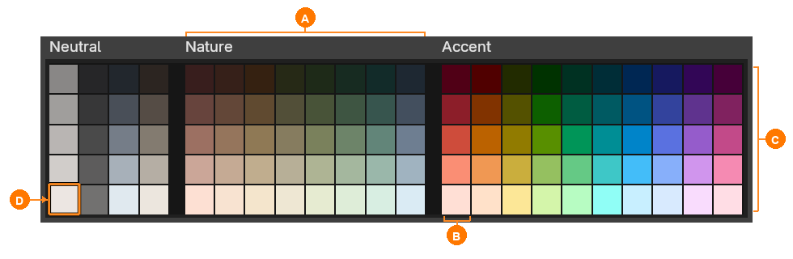
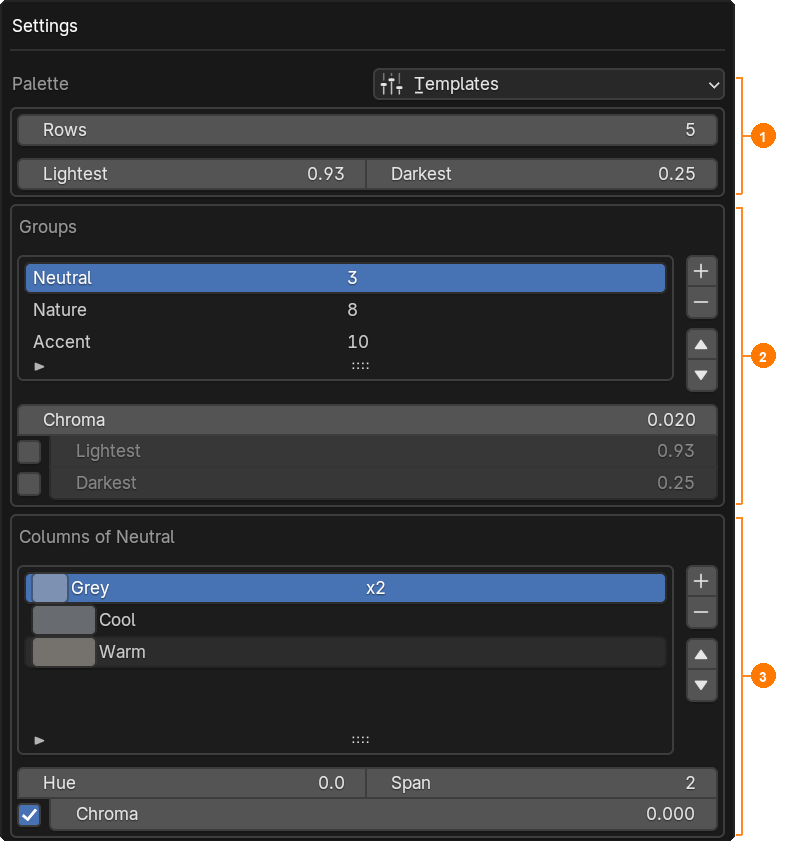
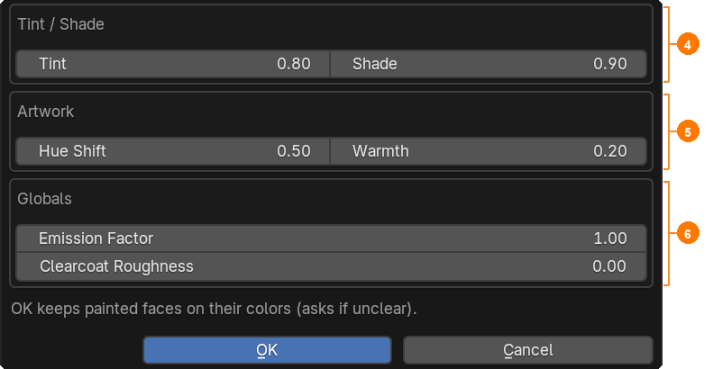

# Color Palette and PBR Presets

In Low Poly Colorizer, color values (albedo) and surface characteristics (PBR parameters) are managed independently and combined during rendering and shading.

---

## The Interactive Modal Palette Picker

Clicking the **Palette button** (color picker) in the N-Panel opens the color palette as a hardware-accelerated GPU overlay directly within the 3D Viewport.

| Area | Description |
|:---:|:---|
| **Ⓐ** | **Group**: The palette is organized in groups (e.g. *Neutral*, *Nature*, *Accent*). Each group shows its name as a heading; a small gap separates the groups. |
| **Ⓑ** | **Columns**: Each column is a hue with its own lightness ramp. A column can span two grid columns—for example a long grey scale with twice as many steps. |
| **Ⓒ** | **Rows**: Vertical progression from light to dark. Row 0, the lightest, is the bottom row. |
| **Ⓓ** | **Active Cell & Selection Frame**: Two-tone highlight frame indicating the currently selected cell $(X, Y)$ with instant assignment on click. |

Below the grid, the picker names the cell under the mouse cursor, e.g. *Nature · Moss 3*. The palette's layout and size are set under *Settings…* (see below).

### Navigation within the Picker Overlay

* **Select & Assign**: Click with the **left mouse button (LMB)** on any cell. The coordinates are stored, assigned to the current selection, and the overlay closes.
* **Zoom**: Scroll the **mouse wheel** to zoom continuously into or out of the palette grid (0.25× to 4.0×).
* **Pan**: Hold the **middle mouse button (MMB)** and drag to reposition the palette window anywhere in the viewport.
* **Cancel**: Press **Right-Click**, **Escape**, or click outside the palette (or into a gap between groups) to close the overlay without changing the current color selection.

---

## PBR Presets: Managing Material Looks

Each preset combines four standardized physical material parameters:

* **Roughness (0.0 – 1.0)**: Surface micro-roughness. Lower values yield sharp mirror reflections; higher values produce a soft, diffuse matte look.
* **Metallic (0.0 – 1.0)**: Metallic proportion. 0.0 corresponds to dielectrics (plastic, wood, stone); 1.0 corresponds to true conductive metals.
* **Emission (0.0 – 1.0)**: Surface self-illumination strength, scaled by the global *Emission Factor* (*Settings…*). The cell's albedo color serves as the emission tint.
* **Clearcoat (0.0 – 1.0)**: Secondary protective clear lacquer layer (e.g. automotive paints, varnished surfaces, or wet finishes).

> [!IMPORTANT]
> **Live Update:** Preset sliders do not modify individual mesh vertices or face loops; they update the central lookup table. Adjusting the *Roughness* of the *Solid* preset updates **every face using *Solid* instantaneously**.

### Extended Preset Menu (`▾`)

* **Duplicate**: Creates a 1:1 duplicate of the active preset to quickly iterate on material variations.
* **Import / Export Palette / Presets**: Saves the palette and the presets to a JSON file and loads them back—ideal for reuse across projects. Checkboxes in the file dialog choose whether the palette, the presets or both are written or taken over. On import, presets with an existing name are updated and new ones are appended; a palette replaces the current one entirely (painted faces follow, see *Painted faces when the palette changes*). Preset files from LPC 1.x can still be imported.
* **Load Default Presets**: Adds the four bundled factory presets (*Solid*, *Metallic*, *Clearcoat*, *Emission*) if missing and resets existing presets of the same name to the factory values.
* **Create Geometry Node Group**: See chapter *Engine Export and Integration*.

---

## Global Settings (*Settings…*)

Clicking **Settings…** in the N-Panel opens the configuration dialog for the palette and the project-wide shader parameters. Changes are previewed live; *OK* applies them, *Cancel* reverts them.

| Area | Description |
|:---:|:---|
| **①** | **Palette & Grid**: The **Templates** menu with the bundled templates, the number of rows (*Rows*) and the lightness range (*Lightest* / *Darkest*). |
| **②** | **Groups**: The list of groups (add, remove, reorder) and the selected group's values: *Chroma* and, optionally, an own lightness range. |
| **③** | **Columns**: The selected group's columns with a color preview, and the selected column's values: *Hue*, *Span* and, optionally, an own *Chroma*. |

| Area | Description |
|:---:|:---|
| **④** | **Tint / Shade**: How much colorfulness fades toward the lightest (*Tint*) and the darkest rows (*Shade*). |
| **⑤** | **Artwork**: Vertical color temperature drift (**Hue Shift**) and global color temperature (**Warmth**). |
| **⑥** | **Globals**: Project-wide parameters such as the global emission multiplier (*Emission Factor*) and the base roughness for clearcoat (*Clearcoat Roughness*). |

---

## Building the Palette: Groups and Columns

The palette consists of **groups**, and each group of **columns**. The order in the picker follows exactly this structure: first the groups, within them their columns.

* **Groups** organize the palette by role. A proven split is *Neutral* (grey and near-neutral tones), *Nature* (muted natural tones for terrain and surroundings) and *Accent* (strong colors for everything gameplay-relevant). A group's *Chroma*—the colorfulness in OKLCH, 0 = grey—applies to all its columns without an own value. Optionally a group gets its own lightness range, for example so its grey reaches almost black without darkening the other colors.
* **Columns** are the actual hues. *Hue* is the hue in degrees (OKLCH), *Chroma* an optional own colorfulness. With *Span 2* a column covers two grid columns: its lightness ramp then runs over twice as many steps, the light half on the left, the dark half on the right.
* **Rows** apply to the whole palette. *Lightest* and *Darkest* set how light the first and how dark the last row is; the steps in between are spaced evenly in perceived lightness.

All colors are computed in the perceptually uniform color space **OKLCH**: equal lightness values look equally light across all hues. Yellows keep their sunny character, blues stay clear and shadow steps do not sink into mud.

### Templates

**Templates** replaces the palette with a bundled template:

* **Stylized 3D** (default for new files): 22 columns × 5 rows in the groups *Neutral*, *Nature* and *Accent*—calm tones for the surroundings, strong accents for what matters in gameplay.
* **Classic Color Wheel**: A grey scale plus 16 evenly spaced hues × 9 rows—laid out like the LPC 1.x default palette, computed in OKLCH.

Templates are JSON files in the same format as *Export Palette / Presets*, so an exported palette can be carried into another project at any time.

### Painted Faces When the Palette Changes

Painted faces store their palette cell. So that they keep their color after the palette is rebuilt, LPC remaps them when you click **OK**:

* **Automatically**: Adding columns, moving them (also between groups), reordering groups and widening a column to *Span 2* are lossless. Every face stays on its column and step; LPC recognizes columns by a fixed, invisible id, not by their position.
* **With a question**: If a used column is deleted, the row count changes or a column is narrowed, the **Remap Painted Faces** dialog opens. It lists each affected old color with the number of its faces and suggests the nearest new color—in the same column if it still exists. Correct the suggestions via X/Y where needed. *Cancel* restores the previous palette.

Color changes (hue, chroma, lightness, tint/shade, artwork) move no cells; faces simply take on the new color of their cell.

---

## Artwork: Color Theory & Shading Harmony

Professional 3D art and painting rarely use pure lightness steps; they work with **color temperature contrasts** (warm sunlight casts cool shadows). The **Artwork** section offers two controls for this:

* **Hue Shift (-1.0 to +1.0)**: Simulates atmospheric lighting.
  * *Positive values (0.3 to 0.5)*: Highlights drift toward the warm axis (yellow/gold), shadows toward the cool axis (blue/violet)—ideal for sunny outdoor scenes.
  * *Negative values (-0.3 to -0.5)*: Cool highlights and warmer shadows—ideal for night and moonlight scenes.
  * *0.0*: Neutral hues without drift.
* **Warmth (-1.0 to +1.0)**: Global color temperature bias. Subtly shifts all hues and the greys toward amber/gold (+1.0) or cool sky blue (-1.0).

### Recommended Settings (Recipes)

* **Stylized 3D (Outdoor / Sunlight)**: `Hue Shift: 0.5`, `Warmth: 0.2`—the values of the *Stylized 3D* template.
* **Night / Sci-Fi / Moonlight**: `Hue Shift: -0.35`, `Warmth: -0.25`.
* **Neutral**: `Hue Shift: 0.0`, `Warmth: 0.0`.

A level's overall mood belongs in the engine's lighting and post-processing instead—the palette stays the same.

---

## Upgrading from LPC 1.x

LPC 2.0 only knows the model of groups and columns. When you open a file saved with LPC 1.x, LPC converts its palette once:

* The greyscale column becomes the group *Greyscale* (still white to black), the color wheel the group *Color Wheel* with the same hues. The grid keeps its size, **every painted face keeps its cell**.
* *Saturation* becomes the chroma of the *Color Wheel* group, *Brightness* its lightness range. The *Color Mode* switch is gone: all palettes are computed in OKLCH.
* **Colors may change.** Palettes in the former default mode *HSV* look visibly different (different saturation and lightness per hue); palettes in *OKLCH* mode stay practically the same in their hue columns.

After the conversion, the N-Panel and the Settings dialog point it out until you close the note with *Dismiss*. If you need the old colors exactly, stay on LPC 1.2 for that project.
