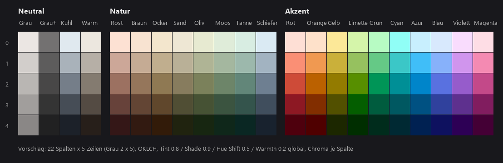

# Plan: Palette mit Gruppen und Spalten

Übergabe aus der podrush-Sitzung vom 2026-11-17. Ziel: LPC erzeugt statt des festen Farbkreises eine
Palette aus Gruppen von Spalten, mit eigener Sättigung je Gruppe/Spalte. Die alte Palette bleibt als
Sonderfall erhalten.

## Warum

* podrush (das Hauptprojekt mit LPC) ist kein reines Low-Poly-Spiel: Das Gelände (TerrainSystem,
  RGB-Farben im Shader) braucht gedämpfte Naturtöne. Die heutige Palette hat nur Farbton (Spalte) und
  Helligkeit (Zeile); die Sättigung ist global. Gedämpfte Töne gehen nur, wenn alles gedämpft wird.
* Grundsatz von Frank: **alle Farben aus der Palette**, keine Farbregler an einzelnen Verbrauchern.
  Einzige Ausnahme: Licht/Postprocessing im Environment.
* Bestandsaufnahme podrush (Stand 2026-11-17, Palette 17 × 16): Die Meshes nutzen nur 22 Zellen;
  **77 % der Flächen** liegen in der Graustufenspalte (9 verschiedene Zeilen, 6 davon im Dunkeln),
  14 % Cyan, der Rest wenige Akzente. Looks/Decals/Gelände nutzen weitere ~20 Zellen. Die meisten
  Farbspalten nutzen nur 1–2 Zeilen.
* Professioneller Aufbau für stilisierte 3D-Spiele: Familien nach Rolle (Neutral / Natur / Akzent)
  statt Farbkreis; Sättigung als Hierarchie (Umgebung ruhig, Spielrelevantes kräftig); Zeilen sind in
  beleuchtetem 3D Material-Varianten, keine Schattenstufen; Stimmung je Level über Licht/Post.

## Die abgenommene Palette

22 Spalten × 5 Zeilen, OKLCH. Frank: „die aktuelle Palette finde ich top“.



| Gruppe | Spalten (Farbton OKLCH, Spitzen-Chroma) |
|---|---|
| Neutral | Grau + Grau+ (eine Rampe über 2 Spalten = 10 Stufen, Chroma 0), Kühl (250°, 0.02), Warm (70°, 0.02) |
| Natur | Rost (35°, 0.06), Braun (55°, 0.055), Ocker (75°, 0.06), Sand (85°, 0.045), Oliv (110°, 0.055), Moos (135°, 0.05), Tanne (165°, 0.045), Schiefer (245°, 0.035) |
| Akzent | Rot 25°, Orange 50°, Gelb 90°, Limette 125°, Grün 150°, Cyan 195°, Azur 235°, Blau 265°, Violett 300°, Magenta 345° — alle 0.17 |

Global: Zeilen 5, L oben 0.93, L unten 0.25, Tint 0.8, Shade 0.9, Hue Shift 0.5, Warmth 0.2.
Rechnung wie `color_at()` im OKLCH-Zweig (Farbton-Drift zu den Polen 95°/265°, Chroma-Abfall durch
Tint/Shade, `_oklch_to_rgb_clamped`), nur mit Chroma je Spalte statt `0.16 * saturation` und
L-Bereich statt `(0.94 - 0.72 t) * brightness`. Grau (Chroma 0) wie die heutige Graustufenspalte im
OKLCH-Zweig. Referenz-Generator siehe Anhang.

## Entscheidungen

* **Zwei Ebenen:** Palette → Gruppen → Spalten. Rasterreihenfolge = Gruppenreihenfolge, darin
  Spaltenreihenfolge.
* **Gruppe:** Name (Überschrift + Lücke im Picker), Chroma-Vorgabe (Spalten ohne eigenen Wert erben),
  optionaler L-Bereich `l_top`/`l_bottom` (ohne eigenen Wert gilt der globale, jedes Ende einzeln;
  z. B. Grau bis fast Schwarz, ohne die Farben abzudunkeln), Reihenfolge (verschiebt als Block).
* **Spalte:** `name`, `hue`, `chroma` (optional, sonst Gruppe), `span` (1 oder 2; Grau läuft über 2
  Spalten), `id` (stabil, unsichtbar, für die Umrechnung).
* **Global** bleiben: Zeilen, L-Bereich (ersetzt Brightness), Tint, Shade, Hue Shift, Warmth. Das
  globale Saturation entfällt im neuen Modell. Nur noch OKLCH, kein HSV-Modus mehr (in HSV hat eine
  Zeile keine gleiche wahrgenommene Helligkeit).
* **Kompatibilität (entschieden 2026-11-17): LPC 2.0 mit eingeschränkter Abwärtskompatibilität.**
  Das alte Modell (HSV, Saturation/Brightness, eigene Formeln) entfällt ganz. Alte Szenen werden
  einmalig umgewandelt (`palette_from_params`): Gruppe „Greyscale“ (1 Grau-Spalte, nur wenn
  `add_greyscale`, eigener L-Bereich 1.0 … 0.0 = Weiß bis Schwarz wie bisher) + Gruppe „Color Wheel“ (N gleich verteilte Töne, Chroma `0.16 × saturation`,
  L-Bereich `(0.94 … 0.22) × brightness`). Das **Raster bleibt gleich**, jede bemalte Fläche behält ihre
  Zelle, kein Remap nötig. Die **Farben ändern sich**: OKLCH-Szenen nur in der Graustufenspalte
  (jetzt bis Weiß/Schwarz), HSV-Szenen (der bisherige Standard) in den Farbspalten sichtbar. Hinweis im
  CHANGELOG und beim ersten Öffnen einer alten Szene. Spalten-IDs der Farbkreis-Töne = Farbton als
  gekürzter Bruch (`hue-1/8`), damit gleiche Töne bei späterem Spaltenwechsel automatisch passen.
* **Rasteränderung sicher machen** (heute zerstört jede Änderung von Columns/Rows die Bemalung, weil
  `lpc_uv0` normiert `(x + 0.5) / cols` speichert und nichts umgerechnet wird):
  * automatisch: alle bemalten Flächen der .blend umrechnen — mit alten Maßen dekodieren
    (`decode_palette_uv`), Spalte über `id` finden, mit neuen Maßen kodieren (`encode_palette_uv`).
    Hinzufügen, Verschieben, `span` ändern sind so verlustfrei.
  * mit Rückfrage: gelöschte Spalten oder geänderte Zeilenzahl → Zuordnungstabelle alt → neu,
    vorbelegt nach nächster Farbe (OKLab), von Hand korrigierbar; betroffene Flächen melden.
* **Import/Export (JSON, `version: 2`):** eine Datei mit den Abschnitten `palette` und `presets`.
  Export mit Haken für beide. Import: Presets wie heute nach Namen zusammenführen; Palette ersetzt als
  Ganzes und läuft bei bemalter Szene über die Umrechnung (gleiche Spalten-IDs automatisch, sonst
  Tabelle). Dateien mit `version: 1` (nur Presets) bleiben lesbar.
* **Vorlagen** = mitgelieferte JSON-Dateien im selben Format („Klassischer Farbkreis“,
  „Stilisiertes 3D“ = die Palette oben). Vorlagen-Knopf = Import aus diesem Ordner.
* **Godot-Export:** `PALETTE`, `PALETTE_COLS`, `PALETTE_ROWS` bleiben unverändert (Shader und
  `color_at()` merken nichts). Neu: `PALETTE_GROUPS` (Name, erste Spalte, Anzahl) und Spaltennamen;
  `palette_cell_x` als Auswahlfeld mit Labels „Natur · Moos“ (gespeichert bleibt die Zahl; Godot-Enums
  haben keine Untermenüs). Warnung in der Vorlage: Umsortieren verschiebt gespeicherte Zellen, wie bei
  Presets.

## Reihenfolge

1. ✅ Gruppen-/Spaltenmodell in `addon/model/palette.py` (rein, ohne bpy) + Umwandlung alter
   Parameter; Tests: gleiches Raster, OKLCH-Farbspalten unverändert, abgenommene Palette wie im Anhang.
2. ✅ Umrechnung beim Rasterwechsel in `addon/model/remap.py` (rein + Tests), inkl. Zuordnungstabelle.
3. 🟡 Blender: PropertyGroups (Gruppen-Collection mit Spalten-Collection), Liste, Vorlagen, Picker mit
   Gruppenüberschriften. Umgesetzt, Hintergrund-Rauchtest in Blender 5.3 grün; **UI-Test durch Frank
   offen**. Bearbeitung nur im Settings-Dialog, OK übernimmt (Umrechnung, ggf. Tabellen-Dialog),
   Abbrechen stellt wieder her. Neue Dateien starten mit „Stylized 3D“; Vorlagen liegen als JSON
   (`version: 2`) in `addon/templates/`.
4. ✅ JSON `version: 2` (Palette + Presets), Vorlagen-Dateien: `addon/ops/file_io.py`, Menü
   „Preset Extras“ → Import/Export Palette / Presets (Haken für beide Teile, auch beim Import).
   Import nicht im Settings-Dialog (würde sonst doppelt umrechnen). Gerundet auf 4 Stellen
   (float32-Rauschen). Hintergrund-Rauchtest grün; UI-Test durch Frank offen.
5. ✅ Godot-Export: `PALETTE_GROUPS`, `PALETTE_COLUMN_NAMES`, `palette_cell_x` als `@export_enum`
   (in Godot 4.8 headless geprüft); README-Vorlage; Handbuch Kap. 3/4 (de/en), Vorwort, README,
   description, CHANGELOG 2.0.0, Version 2.0.0. **Offen:** Screenshots (`capture_screenshots.py`
   arbeitet mit festen 4K-Koordinaten, Picker/Settings haben sich geändert) und PDFs neu bauen.
6. Danach in podrush: Umzug (siehe unten).

## Farbfeld `color` in der Godot-Ressource ✅

Schreibgeschütztes Farbfeld `color` in `{{prefix}}palette_color_resource.gd.tpl`: mit 91b52de
committet, samt CHANGELOG (1.2.0), Handbuch und Exporter-Test.

## Umzug in podrush (nach LPC)

* Zuordnung der heutigen Graustufen auf Grau/Grau+ nach OKLab-L: (0,0),(0,1) → Grau 0; (0,2) → Grau 1;
  (0,7) → Grau 4; (0,10) → Grau+ 1; (0,11) → Grau+ 2; (0,12),(0,13) → Grau+ 3; (0,14),(0,15) → Grau+ 4.
* Bemalung in Blender per Tabelle umrechnen, GLBs neu exportieren; Zellen in .tres/.tscn einmalig
  umschreiben (Wegwerfschritt, kein Skript im Repo).
* Danach fliegen die Regler `saturation`/`lightness`/`hue_shift` aus `TerrainColorSetResource` raus;
  die Gelände-Sets (`terrain_color_set_default`, `_moss`) bekommen Zellen aus der Natur-Gruppe.
* Offen: `adjustment_saturation` in den Environments (1.12–1.2) auf 1.0, damit Palette und Bild
  übereinstimmen — Vorschlag, noch nicht entschieden.

## Anhang: Referenz-Generator

Erzeugt die abgenommene Palette als Bild (`python palette_proposal.py <ausgabeordner> 5`). Nutzt die
OKLab-Helfer aus `addon/model/palette.py`.

```python
import sys, importlib.util
from PIL import Image, ImageDraw, ImageFont
spec = importlib.util.spec_from_file_location("lpcpal", r"E:\Projekte\low-poly-colorizer\addon\model\palette.py")
P = importlib.util.module_from_spec(spec); spec.loader.exec_module(P)
OUT = sys.argv[1]

ROWS = int(sys.argv[2]) if len(sys.argv) > 2 else 5
L_TOP, L_BOTTOM = 0.93, 0.25
G = dict(tint=0.8, shade=0.9, hue_shift=0.5, warmth=0.2)

# (Name, Farbton, Spitzen-Chroma[, Hälfte der Grau-Rampe])
GROUPS = [
    ("Neutral", [("Grau", 0, 0.0, 0), ("Grau+", 0, 0.0, 1), ("Kühl", 250, 0.02), ("Warm", 70, 0.02)]),
    ("Natur", [("Rost", 35, 0.06), ("Braun", 55, 0.055), ("Ocker", 75, 0.06), ("Sand", 85, 0.045),
               ("Oliv", 110, 0.055), ("Moos", 135, 0.05), ("Tanne", 165, 0.045), ("Schiefer", 245, 0.035)]),
    ("Akzent", [("Rot", 25, 0.17), ("Orange", 50, 0.17), ("Gelb", 90, 0.17), ("Limette", 125, 0.17),
                ("Grün", 150, 0.17), ("Cyan", 195, 0.17), ("Azur", 235, 0.17), ("Blau", 265, 0.17),
                ("Violett", 300, 0.17), ("Magenta", 345, 0.17)]),
]

def cell(h0, cpeak, y, half=None):
    t = y / (ROWS - 1)
    if half is not None:   # Grau als eine Rampe über zwei Spalten
        t = (half * ROWS + y) / (2 * ROWS - 1)
    hs, w = G["hue_shift"], G["warmth"]
    h = (h0 + w * 30.0) % 360.0
    if t <= 0.5:
        rf = 1 - t / 0.5
        diff = (95.0 - h + 180) % 360 - 180
        h = (h + diff * 0.22 * abs(hs) * rf) % 360
        C = cpeak * (1 - 0.5 * G["tint"] * rf)
    else:
        rf = (t - 0.5) / 0.5
        diff = (265.0 - h + 180) % 360 - 180
        h = (h + diff * 0.28 * abs(hs) * rf) % 360
        C = cpeak * (1 - 0.25 * G["shade"] * rf)
    L = L_TOP - (L_TOP - L_BOTTOM) * t
    if cpeak == 0:   # reines Grau: Temperatur-Drift wie die heutige Graustufenspalte
        cool = (t - 0.5) * 0.02 * hs; wb = w * 0.01
        return P._oklab_to_srgb(L, wb - cool * 0.4, wb - cool * 0.8)
    return P._oklch_to_rgb_clamped(L, C, h)

S, GAP, TOP, LEFT = 46, 18, 70, 40
font = ImageFont.truetype("C:/Windows/Fonts/segoeui.ttf", 13)
big = ImageFont.truetype("C:/Windows/Fonts/segoeuib.ttf", 16)
ncols = sum(len(g[1]) for g in GROUPS)
img = Image.new("RGB", (LEFT + ncols * S + GAP * (len(GROUPS) - 1) + 20, TOP + ROWS * S + 60), (24, 24, 28))
d = ImageDraw.Draw(img)
x = LEFT
for gname, cols in GROUPS:
    d.text((x, 12), gname, fill=(235, 235, 235), font=big)
    for spec in cols:
        cname, h0, cp = spec[:3]; half = spec[3] if len(spec) > 3 else None
        d.text((x + 2, 40), cname, fill=(180, 180, 180), font=font)
        for y in range(ROWS):
            r, g, b = cell(h0, cp, y, half)
            d.rectangle([x, TOP + y * S, x + S - 2, TOP + y * S + S - 2],
                        fill=(int(r * 255), int(g * 255), int(b * 255)))
        x += S
    x += GAP
for y in range(ROWS):
    d.text((12, TOP + y * S + 14), str(y), fill=(150, 150, 150), font=font)
img.save(OUT + "/palette_vorschlag_%dzeilen.png" % ROWS)
```
